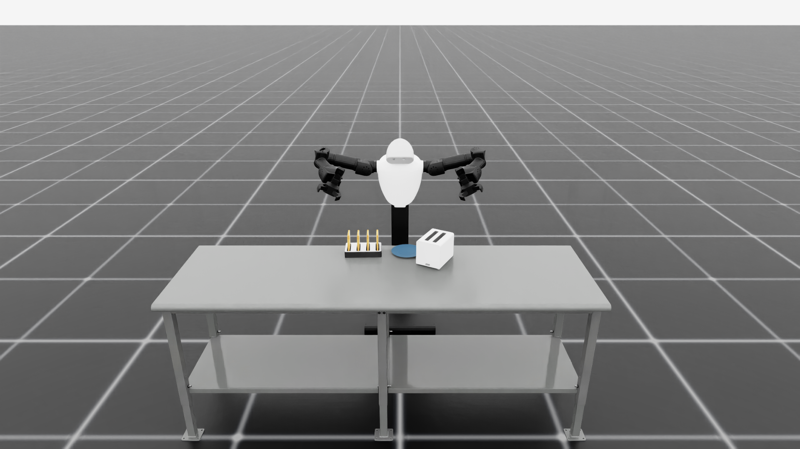

# cyclo_lab_toast

<p align="center">
  
</p>

**Original Framework:** https://github.com/ROBOTIS-GIT/cyclo_lab

**Direct Toast Baseline:** https://github.com/badajhong/cyclo_lab

**Direct Toast Baseline Commit:** [`5f5086d11f664494119086de30a9e925b12022ad`](https://github.com/badajhong/cyclo_lab/commit/5f5086d11f664494119086de30a9e925b12022ad)

An Isaac Sim toast preparation environment with Meta Quest bimanual teleoperation,
gripper control and demonstration recording. It combines a simulated toast cycle,
three reproducible scenario sets, and HDF5/video capture for reviewing attempts.
Serving v2 succeeds when at least one heated slice is placed on the plate after
pop-up, with the lever released and the required placement checks satisfied.
See [task details](docs/TASK.md) and the [documentation index](docs/README.md).

> **Pre-publication status:** keep this repository private until redistribution
> rights for the included bread rack are established. Upload authorization is not
> evidence of the copyright holder's permission. Fresh network installation,
> GPU/GUI execution, live Quest control, recording and GPU replay remain unverified
> in this review. See the [current publication review](docs/PREPUBLICATION_REVIEW.md).

## Project lineage and scope

The Cyclo Lab framework supplies the robot integration, IK/control infrastructure
and Isaac Lab recording foundation. The direct toast baseline supplies the toast
task foundation. Retained source headers and licenses identify their authors;
this repository does not claim those components as original work.

The project-specific toast development layer inherited from
[cyclo-toast-teleop](https://github.com/kkkkkmj/cyclo-toast-teleop) includes the
Quest workflow, toast serving/recording integration, three scenario corpora,
selection and provenance/reproduction tools. These describe the project's
additions and adaptations, not an independently verified per-author allocation.
[Historical provenance](docs/release/PROVENANCE.md) records the available baseline
evidence and its limits; the exact ROBOTIS upstream commit is not established.

This repository preserves that distribution's Git history through
`7fc8b5ebfa33de040f70cb5fa3552044f6e7c787`. The changes made here organize the
existing corpora under `scenarios/`, adapt paths and historical reproduction,
and improve documentation. They introduce no new layouts, control/task behavior,
assets or recording format. See the [scenario guide](scenarios/README.md).

The direct-baseline comparison confirms that `FFW_BG2.py`, the selected robot
USD, `arm_action.py`, `gripper_action.py`, task `recorders.py` and the standard
`record_demos.py` are reused unchanged. Toast cycle/success and replay code are
adaptations. Quest transport/recording integration and scenario tools were added
relative to that baseline; this does not establish exclusive authorship or a
from-scratch simulation/recording framework. See the [contribution table](docs/PREPUBLICATION_REVIEW.md#attribution).

## Requirements

- Linux x86-64 with an X11 desktop, a suitable NVIDIA GPU/driver and NVIDIA Container Toolkit.
- Docker with Compose v2, Git LFS, host Python 3.10+ and OpenSSL.
- Meta Quest with Quest Browser, on a network that can reach the PC's HTTPS port.
- RoboDojo downloads and network access to NVIDIA table/material assets.

The Docker image is configured to use Isaac Sim **5.1.0**, Isaac Lab **2.3.0** and PyTorch **2.7.0**.
The robot and bread rack are included; cloning does not install the host stack
or download all external assets. See [asset setup](docs/ASSETS.md).

## Installation

Install the requirements above, then:

```bash
cd ~
git lfs install
git clone https://github.com/kkkkkmj/cyclo_lab_toast.git
cd cyclo_lab_toast
export REPO="$PWD"
git lfs pull
git lfs fsck
python3 scripts/tools/download_make_toast_assets.py
python3 scripts/tools/check_release.py --assets
```

The four `third_party/` dependencies are vendored source snapshots. Keep them at
the included versions; `.gitmodules` records upstream URLs but there are no
submodules to initialize. The rack requires no separate acquisition or installer.

Review NVIDIA's license terms before building; `docker/.env.base` sets `ACCEPT_EULA=Y`.

```bash
docker compose --project-name cyclo-toast-teleop --env-file docker/.env.base \
  -f docker/docker-compose.yaml -f docker/compose.mj.yaml --profile base build cyclo_lab
```

Keep both Compose files. The host checkout is mounted at `/workspace/cyclo_lab`
and the image is `cyclo-toast-teleop:isaacsim-5.1.0`. These inherited Docker names
are intentional; the GitHub repository and checkout are named `cyclo_lab_toast`.
They can collide with an existing baseline deployment. Before building or running,
inspect existing projects/images and use the [isolated validation procedure](docs/LIVE_VALIDATION.md)
if the baseline environment is already present. The default Compose configuration
uses host networking/IPC and all GPUs; a distinct container name alone does not
isolate GPU load or ports.

## GUI preview

Run in your desktop terminal. `echo "$DISPLAY"` and `echo "$XAUTHORITY"` show session values; keep those values when present. `:0` and `$HOME/.Xauthority` below are fallbacks, not universal desktop locations. If the cookie is elsewhere, set `XAUTHORITY` to that existing file. Do not disable X authentication globally.

```bash
cd ~/cyclo_lab_toast
export REPO="$PWD"
export DISPLAY="${DISPLAY:-:0}"
export XAUTHORITY="${XAUTHORITY:-$HOME/.Xauthority}"
test -f "$XAUTHORITY"
bash scripts/run_mj.sh --gui scripts/tools/view_make_toast_scenario.py \
  --scenario_manifest scenarios/fixed_tpb/manifest.json \
  --scenario_group operator_B_1 --group_index 1 --steps 0
```

This selects `toast_base_20261109_025`. `R` resets the selected layout. Close the preview before starting the recorder.

## Quest connection and demonstration recording

Terminal 1, in the checkout: replace `192.168.1.10` with the PC's LAN address (inspect `hostname -I` or `ip address`). Select an unused port reachable from Quest; the example uses 8766.

```bash
cd ~/cyclo_lab_toast
export REPO="$PWD"
export QUEST_HOST=192.168.1.10
export QUEST_PORT=8766
python3 scripts/quest_diagnostic/server.py \
  --host "$QUEST_HOST" --port "$QUEST_PORT" \
  --bridge-dir "$REPO/logs/quest_toast_recording"
```

Open `https://PC_LAN_IP:8766/` in Quest Browser, accept the local HTTPS certificate, and enter the terminal's single-use **Pair** PIN. `p` + Enter in the server terminal issues a new PIN. Certificates and private keys default to `~/.local/state/cyclo-quest-tls`, outside the checkout. Reload the page when client/server builds differ, then enter VR.

Terminal 2, from the same checkout and desktop session:

```bash
cd ~/cyclo_lab_toast
export REPO="$PWD"
export DISPLAY="${DISPLAY:-:0}"
export XAUTHORITY="${XAUTHORITY:-$HOME/.Xauthority}"
GROUP=operator_B_1 INDEX=1 python3 scripts/record_quest_base.py --dry-run
GROUP=operator_B_1 INDEX=1 python3 scripts/record_quest_base.py
```

The host bridge `$REPO/logs/quest_toast_recording` corresponds exactly to `/workspace/cyclo_lab/logs/quest_toast_recording` in the container. Run only one simulation instance per bridge directory. The base launcher uses fixed bridge and manifest paths; custom teleoperation commands must use the same bridge directory as the server.


Press X to request a new recording. Recording begins when the recorder accepts
the request and displays `REC` / `RECORD_STARTED`.
Success, failure, timeout or tracking stall can end an episode automatically;
the result remains beside `NO REC` until the next accepted start.

## Controls

| Input | Action |
|---|---|
| X, after releasing both squeeze buttons | Request reset/start of a recording attempt |
| Left/right squeeze button | Control the corresponding arm target while held |
| Trigger, while holding the same controller's squeeze button | Control the corresponding gripper |
| A | End the current episode manually |
| R in GUI preview | Reset the selected layout |
| `p` + Enter in server terminal | Issue a new single-use pairing PIN |
| `q` or Ctrl+C in simulation terminal | Request finalization and exit |

Stop the Quest server separately with Ctrl+C. If Isaac Sim remains alive, follow
[shutdown troubleshooting](docs/TROUBLESHOOTING.md#simulator-remains-alive-after-ctrlc)
before starting another session.

## Scenarios and saved data

| Set | Robot left to right | Scenarios |
|---|---|---:|
| [Base](scenarios/fixed_tpb/README.md) | Toaster, plate, rack | 100 |
| [Mixed](scenarios/mixed/README.md) | Six object-order permutations | 100 |
| [PTB](scenarios/fixed_ptb/README.md) | Plate, toaster, rack | 100 |

These are **300 initial layouts, not 300 recorded demonstrations**.
See [scenario design and reproducibility](scenarios/README.md).

Each set has four groups (`operator_A_1`, `operator_A_2`, `operator_B_1`,
`operator_B_2`) with 25 scenarios each. The base launcher uses `GROUP` and
`INDEX=1..25`; its default B_1/index 1 selects `toast_base_20261109_025`.

Each launch creates a new directory such as
`recordings/quest_base_B1/episode_001/run_DATE_TIME_UUID/`, containing launch logs,
scenario metadata and `recording/` HDF5/video outputs. Keep the complete run.
See [recording and playback](docs/RECORDING.md) for other scenario sets, directory
structure, wall-clock video timing and replay commands.

## Known limitations

- Fresh-PC Docker/GPU/Quest end-to-end operation, headset casting and GPU replay
  have not been validated for this release. CPU checks do not establish them.
- Dynamic rack/bread settling and Isaac Sim remaining alive after Ctrl+C are
  unresolved issues. See [troubleshooting](docs/TROUBLESHOOTING.md).
- NVIDIA cloud dependency loading remains unverified. Docker includes some
  dependency ranges and is not a fully locked build.
- The 1:1 target mapping does not guarantee instantaneous robot tracking.
  A successful episode alone does not establish training quality or replay fidelity.

## Attribution and licenses

Based on [ROBOTIS-GIT/cyclo_lab](https://github.com/ROBOTIS-GIT/cyclo_lab) and the
toast work in [badajhong/cyclo_lab](https://github.com/badajhong/cyclo_lab).
Credit their authors, NVIDIA/Isaac Lab, RoboDojo and all retained copyright holders.

See [LICENSE](LICENSE), [LICENSE-IsaacLab](LICENSE-IsaacLab),
[third-party notices](THIRD_PARTY_LICENSES.md) and [provenance](docs/release/PROVENANCE.md).
External assets retain their own terms; the code license grants no new blanket
asset rights. See [asset details](docs/ASSETS.md) for source and licensing information.
